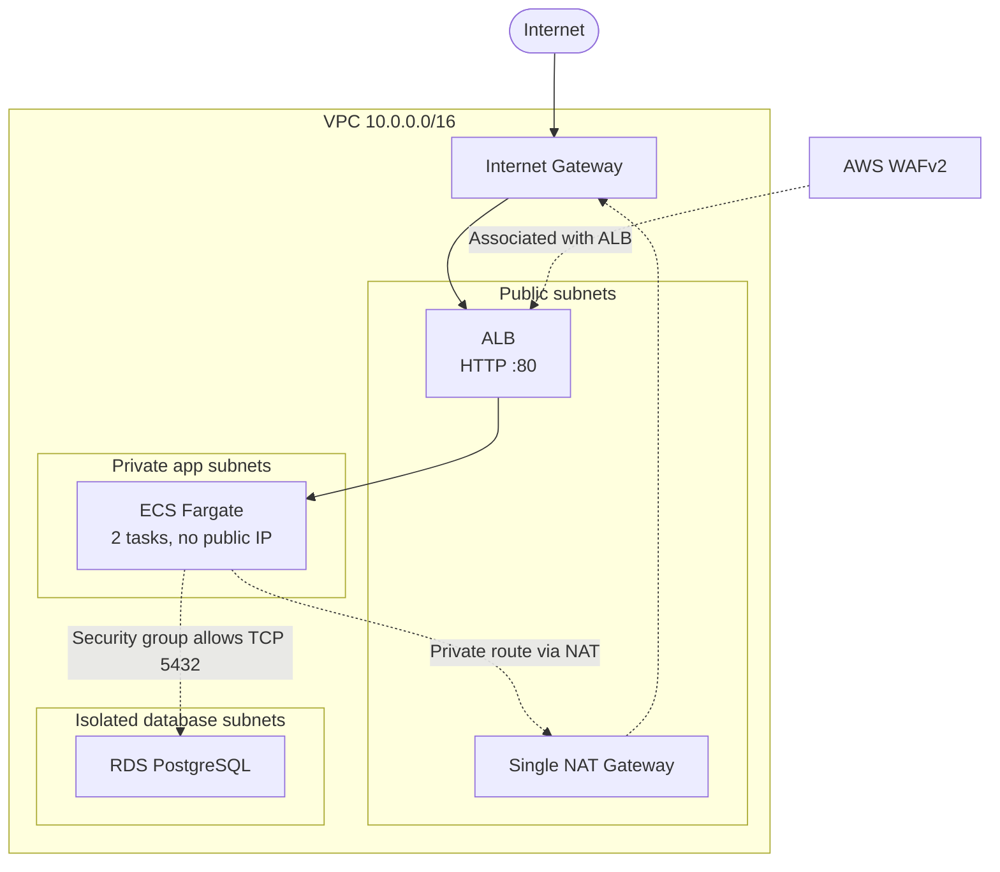

# AWS Terraform Portfolio Project

A small AWS web-stack deployment built with Terraform. It demonstrates VPC networking, ECS Fargate, RDS, WAF, Secrets Manager, and GitHub Actions OIDC.

## Architecture



The ALB is internet-facing. ECS tasks have no public IPs; their inbound traffic is limited to the ALB security group. The database security group permits PostgreSQL traffic from the ECS task security group. The current Nginx container does not itself connect to the database.

## What it creates

- A VPC with public, private application, and database subnets across two Availability Zones.
- An internet-facing Application Load Balancer protected by AWS WAF.
- Two ECS Fargate tasks running `nginx:alpine` in private subnets.
- A PostgreSQL RDS instance, with inbound access restricted to the ECS task security group.
- CloudWatch container logs with seven-day retention.
- An encrypted S3 Terraform backend with DynamoDB state locking.

## CI/CD

GitHub Actions validates Terraform formatting and configuration on pull requests. Pushes to `main` assume an AWS IAM role through GitHub OIDC and run `terraform apply`.

Configure these GitHub Actions values:

- **Variable `AWS_ROLE_ARN`:** ARN of the IAM role trusted for this repository's GitHub OIDC workflow and `prod` environment.
- **Secret `DB_SECRET_ID`:** Secrets Manager secret name or ARN in `ap-south-1`—not the database password.

The IAM role needs permission to manage the Terraform resources, access the S3 state backend and DynamoDB lock table, and read the specified Secrets Manager secret. Grant only the required permissions.

## Deploy

Before running Terraform:

1. Create an S3 bucket and DynamoDB lock table; update `backend.tf` with their names and region.
2. Create a Secrets Manager secret in `ap-south-1`. It may contain a plain-text password or JSON with a top-level `password` field. The password must be 8–128 characters and exclude `/`, `"`, `@`, and spaces.
3. For local use, authenticate with AWS CLI or another AWS credential provider and set the secret identifier:

   ```bash
   export TF_VAR_db_secret_id="your-secret-name-or-arn"
   ```

4. Initialize, validate, and review the plan before applying:

   ```bash
   terraform init
   terraform fmt -check
   terraform validate
   terraform plan
   terraform apply
   ```

Deployment creates billable AWS resources, including NAT Gateway, ALB, WAF, ECS, RDS, and CloudWatch. Review current regional pricing, monitor costs, and destroy resources when no longer needed.

## Demo limitations

- One NAT Gateway; not highly available.
- HTTP only; no TLS/HTTPS listener.
- Single RDS instance; no Multi-AZ failover.
- Stock Nginx image; no application/database integration.
- The database password is read from Secrets Manager, but Terraform manages the RDS password and may store it in state. Restrict access to the state bucket and its backups.
