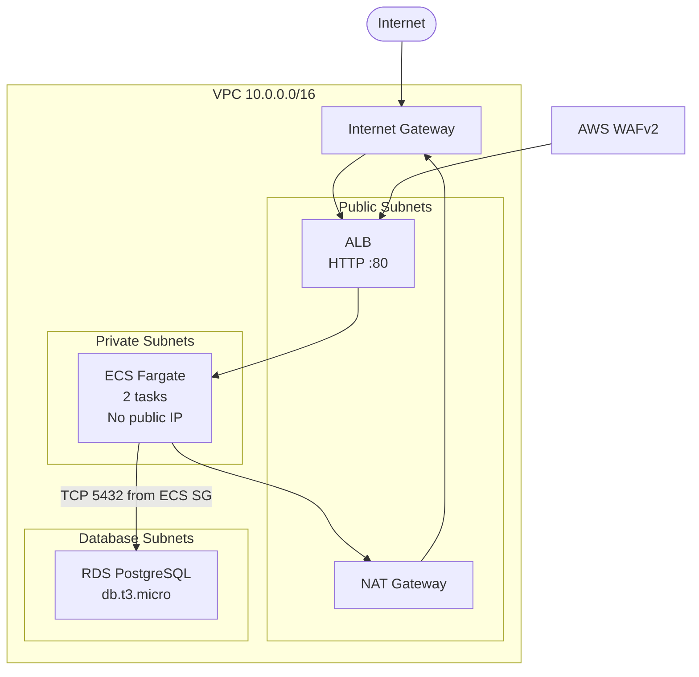
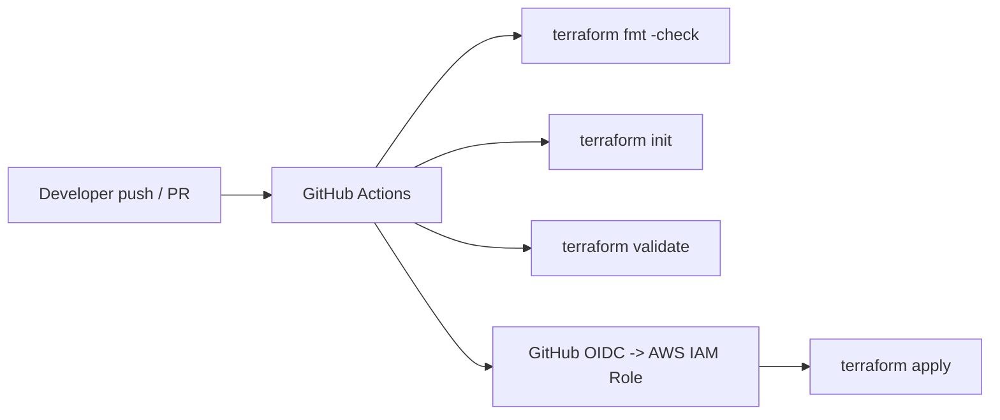

# AWS Terraform Portfolio Project

This repository contains a small AWS infrastructure project built with Terraform. It provisions a VPC, public ALB, ECS Fargate service, WAF, and PostgreSQL RDS instance.

This is a personal portfolio project for Cloud Engineer / DevOps job applications. It is intentionally simple and demonstrates core AWS networking, security, and automation patterns without pretending to be a production-grade enterprise platform.

## Before you deploy

- Deploying this stack creates live AWS resources and can incur charges.
- Costs may include NAT Gateway, ALB, WAF, ECS, RDS, CloudWatch logs, and data transfer.
- Use your own AWS account and review the Terraform plan before applying.
- Create your own Terraform backend bucket and DynamoDB lock table before `terraform init`.
- Keep database credentials in AWS Secrets Manager; do not commit passwords to the repository.

## Architecture



Key design decisions:

- Public traffic terminates at the ALB, not directly at ECS.
- ECS tasks run in private subnets with `assign_public_ip = false`.
- Private subnets route outbound traffic through a single NAT Gateway.
- Database access is limited to the ECS task security group on port 5432.
- WAF is attached to the ALB to add basic web request filtering.

## What this project does

- Provisions a custom VPC with public, private, and isolated database subnets.
- Creates an internet-facing ALB with an HTTP listener on port 80.
- Runs a Fargate service with two `nginx:alpine` tasks in private subnets.
- Protects the ALB with AWS WAFv2 managed rules and rate limiting.
- Deploys an RDS PostgreSQL instance with a security-group-based access rule.
- Stores Terraform remote state in S3 with DynamoDB locking.
- Runs Terraform validation and deploy automation in GitHub Actions.

## CI/CD flow



The deployment workflow uses GitHub OIDC instead of long-lived AWS access keys. This keeps credentials out of the repository and follows least-privilege access by using an IAM role with only the permissions required for Terraform.

## Demo/project limitations

This is not a production-grade application platform. The goal is to demonstrate infrastructure fundamentals clearly and honestly.

- Single NAT Gateway is a demo design, not a highly available production pattern.
- ALB is HTTP only; no TLS/HTTPS certificate is configured.
- The application is the stock `nginx:alpine` image; it is not a full app with DB connectivity logic.
- RDS is a single-instance PostgreSQL deployment.
- There is no multi-AZ failover, no autoscaling, no Kubernetes, and no advanced networking hardening.
- Terraform state must still be protected and access controlled.

## Repository layout

```text
.
├── .github/
│   └── workflows/
│       └── terraform.yml
├── backend.tf
├── main.tf
├── variables.tf
├── modules/
│   ├── vpc/
│   │   ├── main.tf
│   │   ├── outputs.tf
│   │   └── variables.tf
│   ├── ecs/
│   │   ├── main.tf
│   │   ├── outputs.tf
│   │   └── variables.tf
│   └── rds/
│       ├── main.tf
│       ├── outputs.tf
│       └── variables.tf
├── README.md
└── .gitignore
```

## Requirements

- Terraform `>= 1.5.0`
- AWS account with permissions to create VPC, ECS, ALB, WAF, and RDS resources
- S3 bucket and DynamoDB lock table for the remote backend
- AWS Secrets Manager secret containing the PostgreSQL password

## Local workflow

```bash
terraform init
terraform fmt
terraform validate
terraform plan
terraform apply
```

For local runs, authenticate with AWS CLI or another AWS credential provider. Do not hardcode credentials in files or shell history.

Set the variable `db_secret_id` to the ARN or name of your Secrets Manager secret before running Terraform:

```bash
export TF_VAR_db_secret_id="arn:aws:secretsmanager:REGION:ACCOUNT_ID:secret:your-db-password"
```

If using GitHub Actions, configure the AWS role ARN as a repository or environment secret and let the workflow assume that role with OIDC.

## Manual configuration needed

Before deploying, complete the following in AWS:

1. Create an S3 bucket for the Terraform backend and a DynamoDB table for locking.
2. Update `backend.tf` with your bucket name, region, and lock table.
3. Create a secret in AWS Secrets Manager for the PostgreSQL password.
4. Set the secret ID as `TF_VAR_db_secret_id` locally or as a GitHub secret in the workflow.
5. Create an IAM role for GitHub OIDC and store the role ARN in a GitHub Action secret.

## Security note

This project keeps the password in AWS Secrets Manager instead of committing it to the repo, but Terraform state and provider metadata still require controlled access. Restrict S3 backend access, rotate secrets regularly, and avoid storing unneeded credentials in local files.
