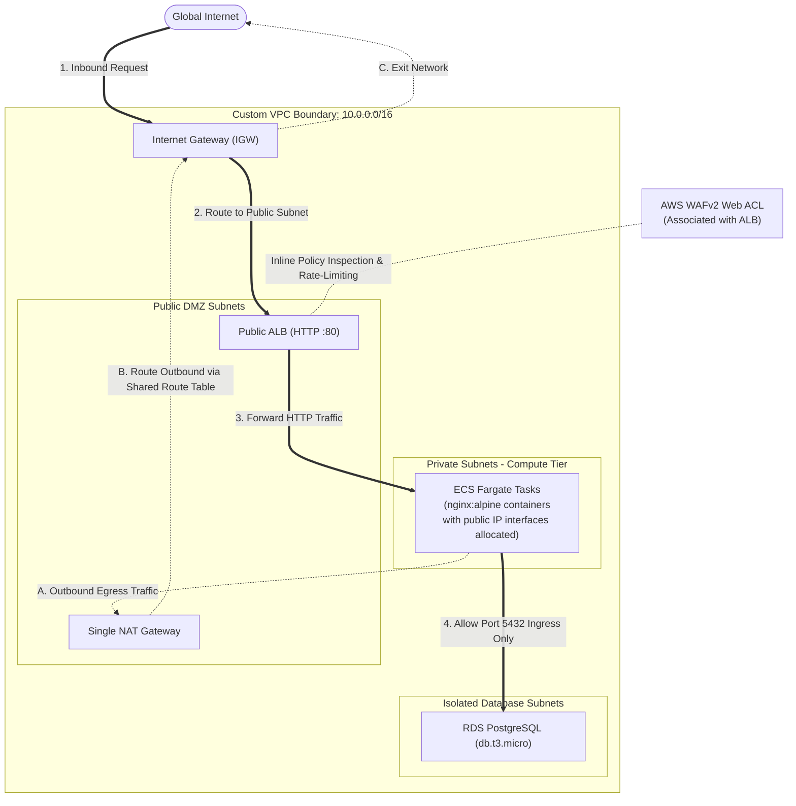

# AWS ECS Fargate and PostgreSQL Infrastructure

This repository contains Terraform configuration for a small AWS web stack. It creates a VPC, an internet-facing Application Load Balancer (ALB), an ECS Fargate service running the stock `nginx:alpine` image, and a PostgreSQL RDS instance.

This is a starter/demo configuration, not a production-ready application. Review the security and availability notes below before deploying it to an AWS account.

## Before you deploy

Deploying this configuration creates resources in **your AWS account** and can incur charges. Costs may include the NAT Gateway, Application Load Balancer, WAF, ECS tasks, RDS instance and storage, CloudWatch logs, and data transfer. Charges depend on usage and region; do not assume the resources are covered by the AWS Free Tier. Check current AWS pricing, set a billing budget or alert, and destroy resources you no longer need. Review the Terraform plan before applying.

Use your own AWS account and credentials with permission to create and manage the resources. For local runs, authenticate through the AWS CLI (for example, a named profile or IAM Identity Center) or another supported AWS credential provider. Avoid long-lived access keys where possible.

The S3 backend in `backend.tf` is configured with specific bucket, table, and region values. Create your own S3 bucket and DynamoDB lock table, then update those values before running `terraform init`. Backend settings are separate from normal Terraform input variables.

Provide the database password through `TF_VAR_db_password` using a secure local secret manager or environment setup. If using the included GitHub Actions deployment workflow, configure `AWS_ACCESS_KEY_ID`, `AWS_SECRET_ACCESS_KEY`, and `DB_PASSWORD` as GitHub Actions secrets, preferably scoped to the `prod` environment. The workflow passes the password to Terraform as `TF_VAR_db_password` and runs `terraform apply -auto-approve` on pushes to `main`. Protect the branch and environment, and never commit credentials or the database password.


## Architecture




The VPC module defines public and private subnets from the CIDR lists in the root `main.tf`. It also creates two database subnets using `10.0.21.0/24` and `10.0.22.0/24`. Subnets are assigned to the first available AZs returned by AWS in the configured region; the AZ names are not hard-coded.

The ALB listener accepts HTTP on port 80 and forwards requests to the ECS service. A WAFv2 web ACL is associated with the ALB. The ECS task security group allows inbound port 80 from the ALB security group, and the database security group allows PostgreSQL port 5432 from the ECS task security group.

## What the configuration creates

- A custom VPC with public, private, and database subnets.
- One NAT Gateway in the first public subnet. Both private subnets use a shared private route table that routes outbound traffic through this gateway.
- An internet-facing ALB with an HTTP listener and target group health checks on `/`.
- An ECS cluster and Fargate service with `desired_count = 2`, using the `nginx:alpine` image.
- A WAFv2 web ACL with the AWS Common Rule Set and an IP-based rate-based rule configured with a limit of 500 requests.
- A CloudWatch log group for ECS logs with seven-day retention.
- One PostgreSQL 15.19 RDS instance using class `db.t3.micro` and 20 GiB of allocated storage.
- An S3 Terraform backend configured for encryption and DynamoDB state locking.

## Important limitations and deployment cautions

- **Terraform state contains secrets:** Marking a variable `sensitive` hides it from normal Terraform output, but does not prevent the database password from being stored in Terraform state. Restrict access to the state bucket and its backups. The S3 backend enables encryption, but state access should still be treated as access to secrets.
- **The database is a single instance.** A subnet group spans two AZs, but the RDS instance does not enable Multi-AZ deployment. This does not provide database failover across AZs.
- **Two desired tasks do not guarantee one task per AZ.** The service uses both private subnets, but the configuration does not enforce an even placement across AZs.
- **There is one NAT Gateway.** It is a single point of egress and may be a cross-AZ dependency for workloads in the other AZ. It is not a highly available NAT design.
- **The ALB only serves HTTP.** No HTTPS listener or TLS certificate is configured.
- **S3 versioning is not configured here.** Enable bucket versioning separately if state history and recovery are required.
- **The application is only the stock Nginx image.** It does not deploy application code or connect the web container to the database.

## Repository layout

```text
.
├── .github/
│   └── workflows/
│       └── terraform.yml
├── backend.tf
├── main.tf
├── variables.tf
└── modules/
    ├── vpc/
    │   ├── main.tf
    │   ├── outputs.tf
    │   └── variables.tf
    ├── ecs/
    │   ├── main.tf
    │   ├── outputs.tf
    │   └── variables.tf
    └── rds/
        ├── main.tf
        ├── outputs.tf
        └── variables.tf
```

## Requirements

- Terraform version `1.5.0` or later.

The provider and workflow currently target `ap-south-1`. Update the provider/workflow configuration together if deploying in another region.

## Run Terraform locally

From the repository root:

```sh
terraform init
terraform fmt -check
terraform validate
terraform plan
```

Terraform uses your configured AWS credential provider. Set `TF_VAR_db_password` securely before planning or applying; avoid putting credentials or the password directly in commands that may be saved in shell history.

Review the plan and make sure the backend, AWS account, region, and credentials are correct before deploying:

```sh
terraform apply
```

The GitHub Actions workflow runs formatting, initialization, and validation for pull requests targeting `main`.
